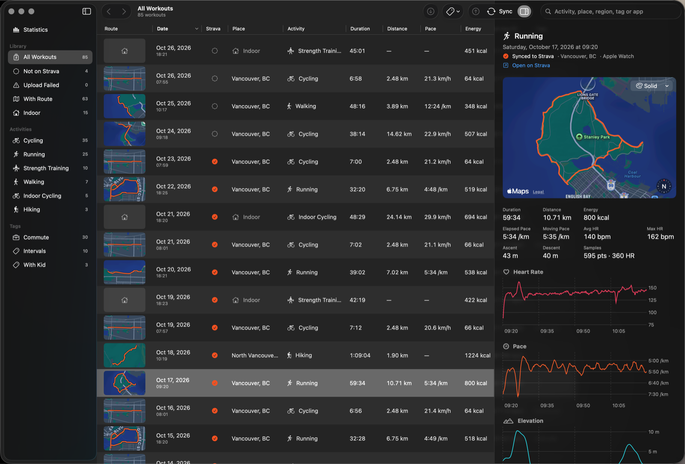
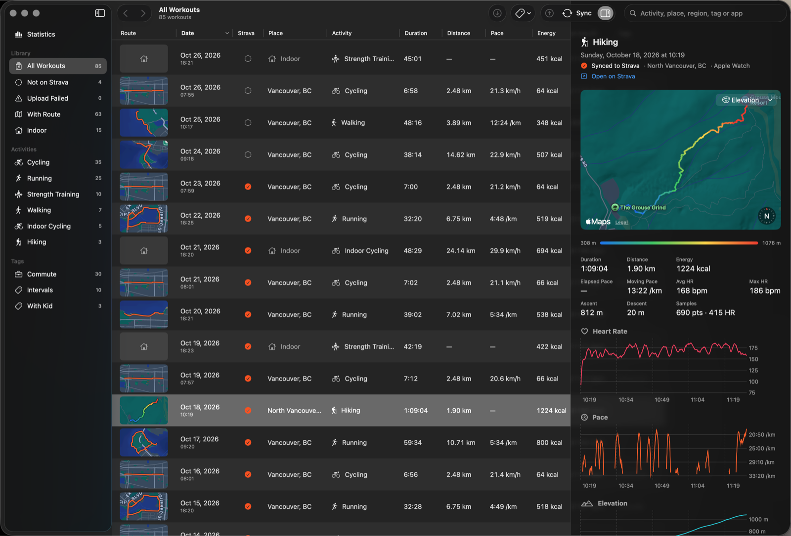
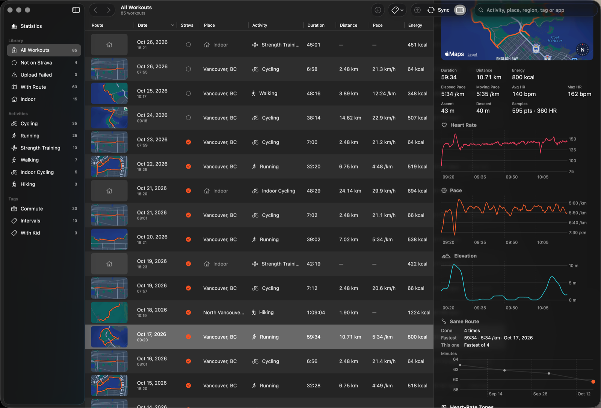
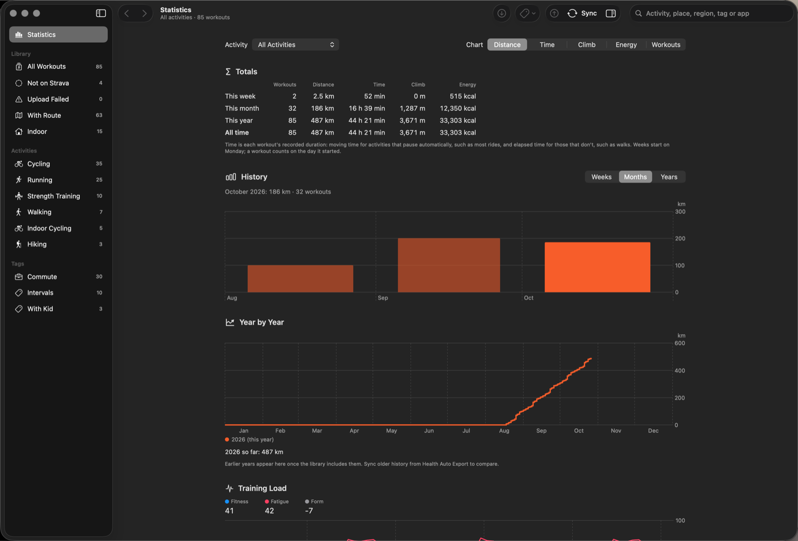
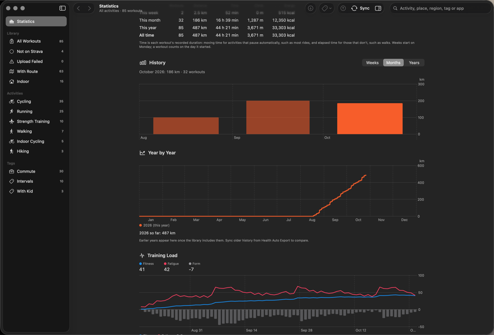
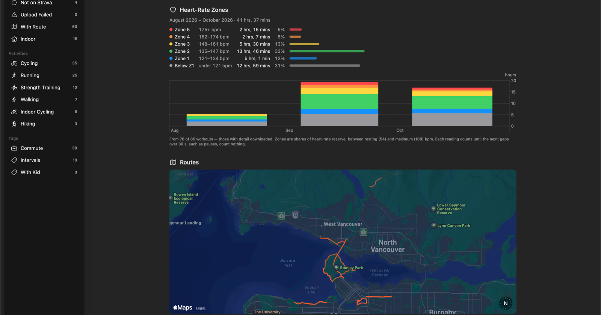

# MaxAct

A fast, native Mac app for browsing your Apple Health workouts — routes, heart rate, pace and
elevation — with your whole history on one screen, and batch upload to Strava.

MaxAct reads workouts from your iPhone through the Health Auto Export app, over your own Wi-Fi. Nothing goes through a
server: your workouts stay on your Mac.

## What it does

**Every workout in one table.** Route thumbnails, date, place, activity, duration, distance, pace
and energy; sort by any column. Filter by activity or tag from the sidebar, or search by activity,
place, region, tag or recording app.

**A detailed inspector.** The route on a map, heart rate, pace and elevation charts, splits and
heart-rate zones. Point at a chart and the map shows where you were. Colour the route by
elevation, gradient, heart rate or pace.

**Same Route.** A route you've done before shows how many times, your fastest, where this one
ranks, and how your time has changed. Click an earlier attempt to open it.

**Statistics.** Totals for the week, month, year and all time; history by week, month or year;
this year against last; and your bests.

**Training load and heart-rate zones.** Fitness, fatigue and form from heart rate (TRIMP), and
time in each zone — once you've set your resting and maximum heart rate.

**Every route on one map**, with the explorer squares you've covered. Click a route to open its
workout.

**Strava.** Upload a selection in one go (TCX, with the sport corrected after), muted so a backlog
doesn't flood your followers' feeds. Commute and trainer tags are mirrored to Strava's flags.
MaxAct finds workouts already on Strava — including ones your watch uploaded — so nothing goes up
twice. You use your own Strava API application; its secret stays in your Keychain.

## What you need

- A Mac running **macOS 26**.
- **Health Auto Export** on your iPhone, with **Premium** (its server is a Premium feature).
- The iPhone and the Mac on the **same Wi-Fi**, with Health Auto Export open and the phone
  unlocked while syncing. Apple doesn't let any app read Health data otherwise.

## Syncing

1. In Health Auto Export, open the **Server** screen. Turn on **HTTPS**, export its CA
   certificate to your Mac, and start the server.
2. In MaxAct's **Settings**, enter the address and token the Server screen shows, turn on
   **Use HTTPS** and load the certificate. MaxAct trusts it for your phone only, never
   system-wide. Test Connection checks it all.
3. Press **Sync** and choose how far back. The phone answers at about 2.4 seconds a workout, so a
   year of history takes a while; you can stop and resume at any point. Routes and second-by-second
   heart rate download separately, on demand or in bulk.

Plain HTTP works too, but anyone on the same network could read your token and workouts.

## Building

Open `MaxAct2.xcodeproj` in Xcode and run the **MaxAct2** scheme. The app's logic lives in the
`MaxActCore` Swift package, tested with `swift test`. `PLAN.md` and `HISTORY.md` are the developer
notes.

## About the screenshots

The screenshots show sample data, not a real person's workouts: ten weeks generated on real paths
in Vancouver (`ShowcaseData`, launched with `--ui-testing-showcase`).

- Route data © [OpenStreetMap](https://www.openstreetmap.org/copyright) contributors, under the
  Open Database License.
- Elevations from the Copernicus DEM GLO-90 (© DLR e.V. 2010–2014 and © Airbus Defence and Space
  GmbH 2014–2018, provided under COPERNICUS by the European Union and ESA; all rights reserved),
  via [Open-Meteo](https://open-meteo.com/).
- Maps by Apple Maps.
